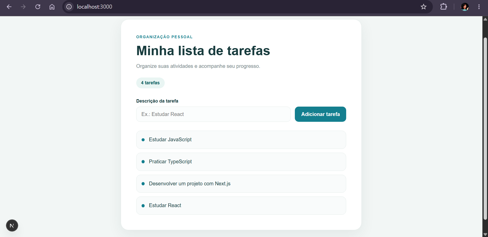
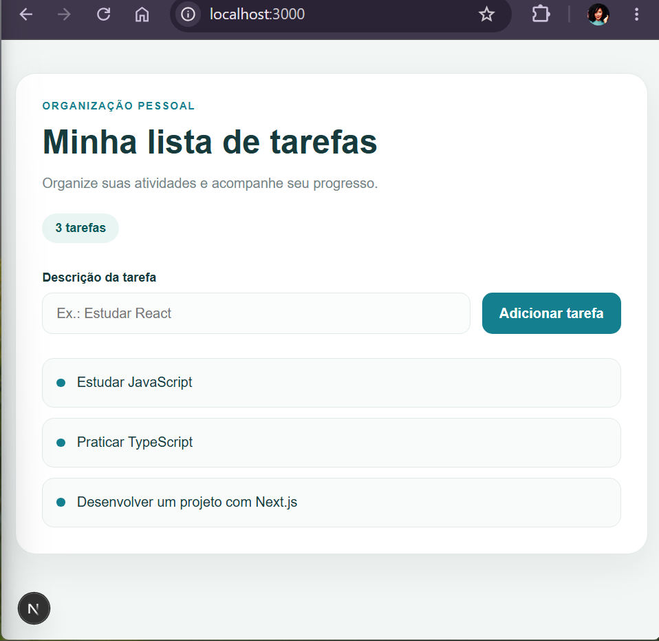
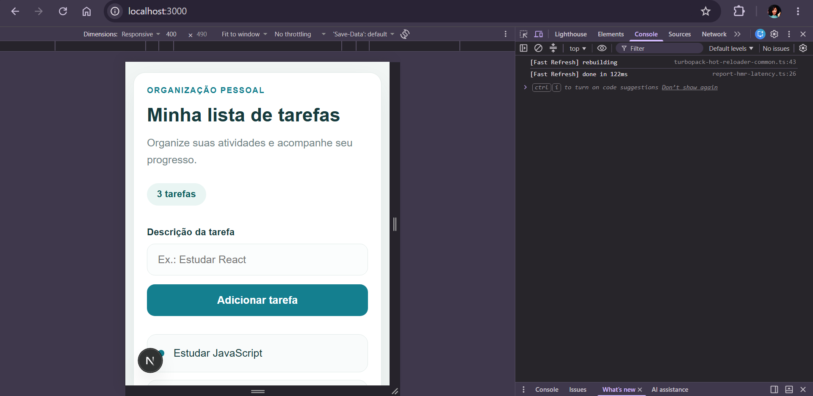

# Lista de Tarefas

Aplicação web de gerenciamento de tarefas desenvolvida com Next.js 15 e TypeScript, permitindo adicionar atividades por meio de um formulário controlado e acompanhar automaticamente a quantidade de tarefas cadastradas.

## Sobre o projeto

Este projeto foi desenvolvido como parte de um desafio prático de desenvolvimento Front-End, com foco em componentização, gerenciamento de estado, hooks personalizados e testes automatizados.

A aplicação utiliza uma fonte de dados local para simular o carregamento inicial das tarefas, mantendo a interatividade no lado do cliente.

## Funcionalidades

- Carregamento de tarefas iniciais por meio de um arquivo local simulado.
- Adição de novas tarefas por formulário controlado.
- Validação para impedir o envio de tarefas vazias ou contendo apenas espaços.
- Atualização automática da quantidade de tarefas.
- Hook personalizado `useContadorDeTarefas`.
- Interface responsiva para desktop, tablet e dispositivos móveis.

## Demonstração visual

### Desktop



### Tablet



### Mobile



## Tecnologias utilizadas

- Next.js 15.5.29
- React
- TypeScript 5.9.3
- CSS3
- Jest 29.7.0
- React Testing Library
- Jest DOM
- JSDOM

## Estrutura do projeto

```text
src/
├── app/
│   ├── globals.css
│   ├── layout.tsx
│   └── page.tsx
│
├── components/
│   ├── NovaTarefa/
│   │   └── NovaTarefa.tsx
│   └── PainelTarefas/
│       └── PainelTarefas.tsx
│
├── data/
│   └── tarefas.ts
│
├── hooks/
│   └── useContadorDeTarefas.ts
│
├── tests/
│   ├── NovaTarefa.test.tsx
│   ├── page.test.tsx
│   └── useContadorDeTarefas.test.ts
│
└── types/
    ├── tarefa.ts
    └── styles.d.ts
```

## Como executar o projeto

### Pré-requisitos

- Node.js compatível com Next.js 15.
- npm.

### Instalação

Clone o repositório e acesse a pasta do projeto:

```bash
git clone URL_DO_REPOSITORIO
cd lista-de-tarefas
```

Instale as dependências:

```bash
npm install
```

Inicie o servidor de desenvolvimento:

```bash
npm run dev
```

Acesse:

```text
http://localhost:3000
```

## Testes automatizados

O projeto utiliza Jest e React Testing Library para verificar os principais comportamentos da aplicação.

Para executar os testes:

```bash
npm run test
```

Para acompanhar os testes em modo interativo:

```bash
npm run test:watch
```

Para gerar o relatório de cobertura:

```bash
npm run test:coverage
```

### Cobertura dos testes

Resultado obtido durante a validação do projeto:

| Métrica    | Cobertura |
| ---------- | --------: |
| Statements |      100% |
| Branches   |      100% |
| Functions  |      100% |
| Lines      |      100% |

Total: 10 testes aprovados em 3 suítes de testes.

## Build de produção

Para gerar a versão otimizada da aplicação:

```bash
npm run build
```

Para executar a versão de produção:

```bash
npm run start
```

## Decisões técnicas

- A página principal utiliza um Server Component para carregar os dados iniciais.
- O componente `PainelTarefas` utiliza estado local para controlar a lista.
- O componente `NovaTarefa` utiliza um formulário controlado.
- O hook `useContadorDeTarefas` calcula a quantidade atual de tarefas a partir do array recebido.
- Os testes verificam a renderização, a validação, a submissão do formulário, o retorno do hook e a integração entre os componentes.

**Observação:** as novas tarefas são armazenadas temporariamente no estado da aplicação. Como não existe persistência em banco de dados ou armazenamento local, elas são reiniciadas ao recarregar a página.

## Autora

Desenvolvido por Isabela Soares como projeto prático de estudos em desenvolvimento Front-End.

Projeto desenvolvido com Next.js, TypeScript e testes automatizados.
